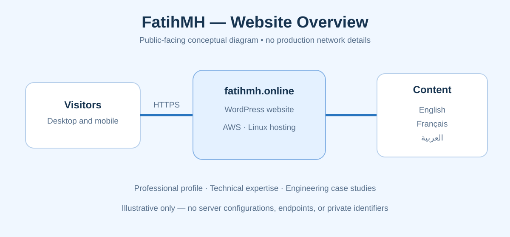

# موقع FatihMH المهني متعدد اللغات

موقع مهني مستقل يعرض الخبرات التقنية ودراسات المشاريع الهندسية باللغات **العربية والإنجليزية والفرنسية**.

**الموقع:** https://fatihmh.online/ar/

الموقع مبني باستخدام **WordPress**، ويعمل في بيئة خادم Linux مخصص مستضاف على **AWS**، من عائلة توزيعات Red Hat.

## أهداف المشروع
- تقديم الخبرات المهنية والمشاريع التقنية في صفحات واضحة ومستقلة.
- دعم ثلاث لغات وتسهيل الوصول إلى المحتوى.
- توثيق المشاريع الهندسية وإتاحة روابط دراسات الحالة.
- توفير منصة قابلة للتحديث وإدارة المحتوى.

**ملاحظة أمنية:** هذا المستودع مخصص للوصف العام فقط، ولا يحتوي على الشيفرة التشغيلية أو عناوين الشبكة أو بيانات الدخول أو إعدادات الخادم أو نسخ قواعد البيانات الاحتياطية.

© 2026 Elfatih Mohamed Hameid Farah — جميع الحقوق محفوظة.
